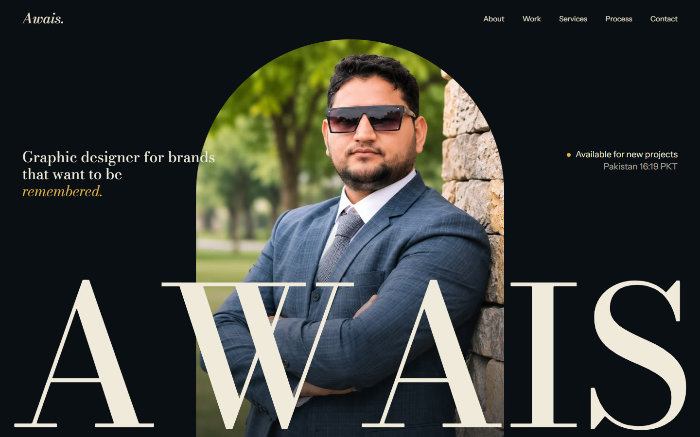
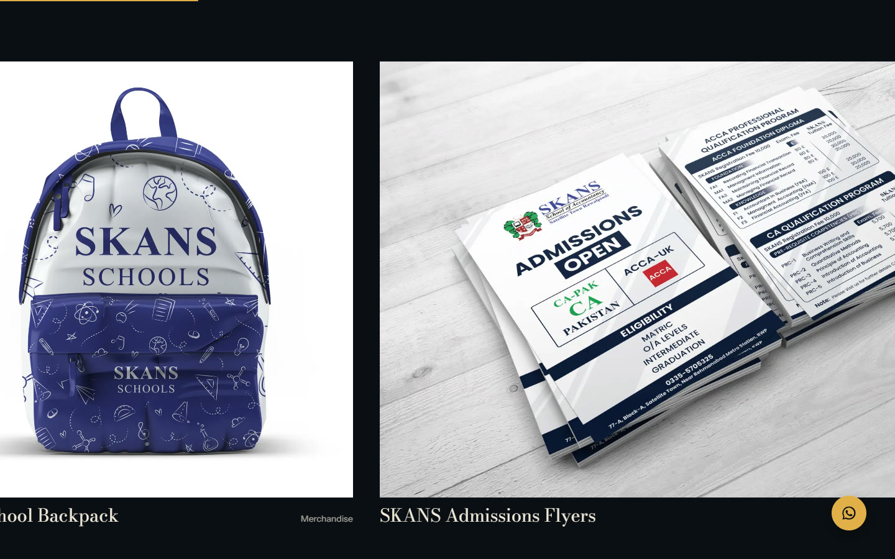
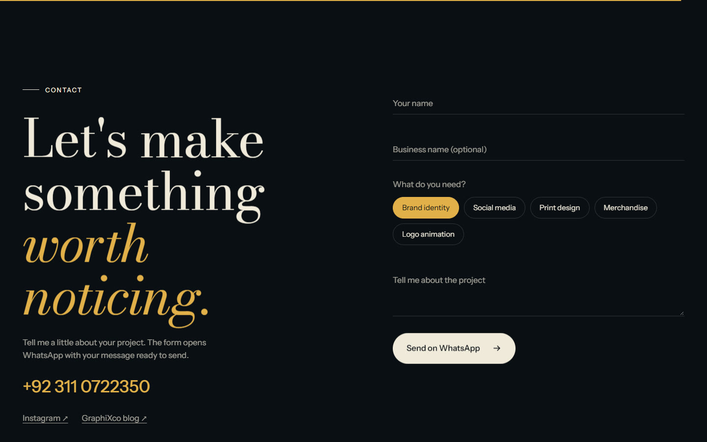
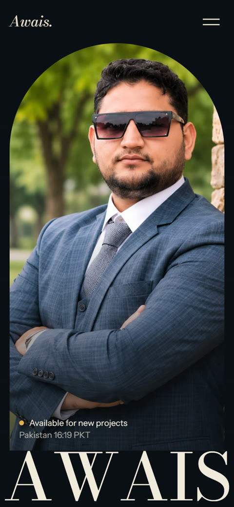

<div align="center">

# Muhammad Awais

**Graphic designer portfolio: brand identity, social media, print and merchandise.**

[View the live site](https://farooq831.github.io/design-studio/) · [WhatsApp](https://wa.me/923110722350) · [Instagram](https://www.instagram.com/graphixxco/) · [Blog](https://graphixco.blogspot.com/)




</div>

## Selected work



| Contact | On a phone |
| --- | --- |
|  |  |

## Features

- **Animated intro:** a counting preloader leads into a portrait and wordmark reveal.
- **Horizontal gallery:** projects scroll sideways on desktop and stack on phones.
- **Project popups:** each one has details, next and previous controls, and a link to the original post.
- **WhatsApp contact form:** validates the fields, then opens WhatsApp with the message ready to send.
- **Scroll animation:** smooth scrolling, word-by-word text reveals, parallax images and a banner that reacts to scroll speed.
- **Responsive:** tested at phone, laptop and large desktop sizes.
- **Accessible:** keyboard-friendly popups, image descriptions, and full support for reduced-motion settings.
- **No build step:** plain files that GitHub Pages can serve directly.

## Built with

HTML, CSS and JavaScript, with [GSAP](https://gsap.com/) and ScrollTrigger for animation and [Lenis](https://lenis.darkroom.engineering/) for smooth scrolling.

## Project structure

```
index.html
assets/
  css/style.css      All styles
  js/projects.js     The project list
  js/main.js         Animation and interaction
  img/               Portraits and project images
  vendor/            GSAP, ScrollTrigger and Lenis
docs/                Screenshots for this page
```

## Run it locally

```
python -m http.server 8000
```

Then open http://localhost:8000.

## Update the site

**Add a project:** put the image in `assets/img/work/`, then copy a block in `assets/js/projects.js` and change its text, link and image path. Set `ratio` to the image's width divided by its height.

**Change the WhatsApp number:** replace `923110722350` in `index.html` and at the top of `assets/js/main.js`.

## Rights

All photographs and project artwork belong to their respective owners and are shown here for portfolio purposes. Please don't reuse them without permission.
